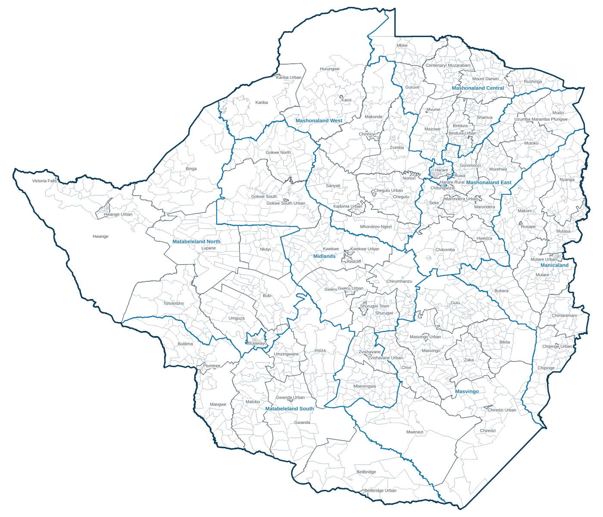
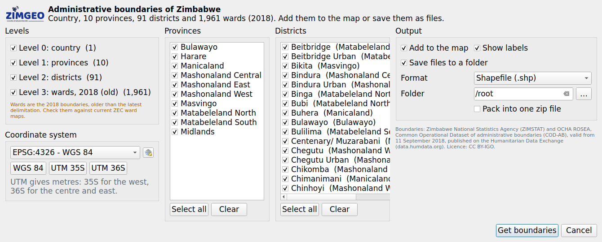

# Zimbabwe Boundaries for QGIS

A QGIS plugin by [Zimgeo](https://www.zimgeo.co.zw) that gives you Zimbabwe's administrative boundaries in one click, with no internet connection needed.

**[Download the plugin (version 1.0.2)](https://github.com/zimgeozw/qgis-zimbabwe-boundaries/raw/main/download/zimbabwe_boundaries.zip)**  |  QGIS 3.4 to QGIS 4



| Level | Layer | Features | Main fields |
|---|---|---|---|
| 0 | Country | 1 | country, pcode |
| 1 | Provinces | 10 | province, prov_pcode |
| 2 | Districts | 91 | district, dist_pcode, province, prov_pcode |
| 3 | Wards (2018, old boundaries) | 1,961 | ward, ward_name, ward_pcode, district, dist_pcode, province, prov_pcode |

Every layer also has `area_km2`, `valid_on` and `source`.

## Features

- Pick any of the four levels
- Filter by province and district
- Reproject to WGS 84, UTM 35S, UTM 36S or any other coordinate system
- Add to the map with styling and labels, or save as Shapefile, GeoPackage, GeoJSON or KML (optionally zipped)
- Works on QGIS 3.4 and later, including QGIS 4



## Install

1. **[Download zimbabwe_boundaries.zip (version 1.0.2)](https://github.com/zimgeozw/qgis-zimbabwe-boundaries/raw/main/download/zimbabwe_boundaries.zip)**
2. In QGIS open **Plugins > Manage and Install Plugins > Install from ZIP**, choose the file and click **Install Plugin**.
3. The tool appears on the toolbar and under **Vector > Zimbabwe boundaries**.

## Use from the Python console

```python
from zimbabwe_boundaries import core
wards = core.make_layer(3, provinces=['Manicaland'], districts=['Mutare'])
core.save_layers([wards], r'C:\GIS\out', 'ESRI Shapefile')
```

## Data source and licence

Zimbabwe National Statistics Agency (ZIMSTAT) and OCHA ROSEA, Common Operational Dataset of administrative boundaries (COD-AB), valid from 11 September 2018, published on the [Humanitarian Data Exchange](https://data.humdata.org). Licence: CC BY-IGO. Please credit the source on maps made with these boundaries.

The wards are the 2018 ward boundaries, which are older than the latest ward delimitation. Check them against current Zimbabwe Electoral Commission ward maps before using them for electoral or ward-level planning work.

`docs/build_data.py` shows how the bundled GeoPackage was built from the original shapefiles.

## Issues and contact

Report problems on the [issue tracker](https://github.com/zimgeozw/qgis-zimbabwe-boundaries/issues).

Map Tech (Pvt) Ltd t/a Zimgeo, 12th Floor, Joina City, Harare, Zimbabwe. aldridge@zimgeo.co.zw | +263 719 751 574

The plugin code is licensed under the GNU General Public License v2 or later. See [LICENSE](zimbabwe_boundaries/LICENSE).
